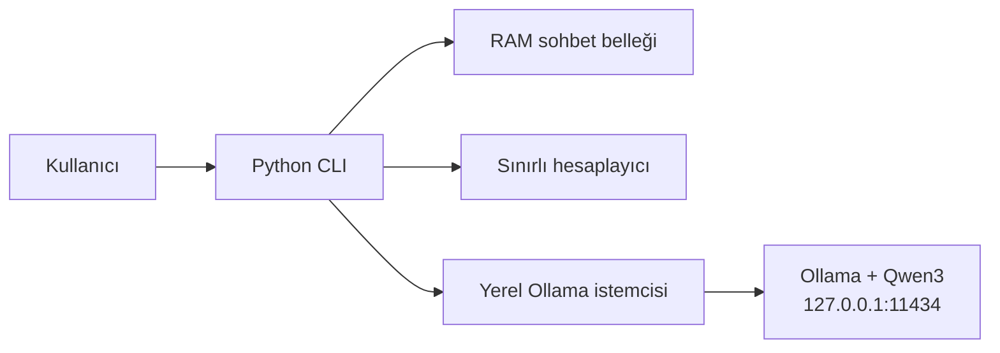

# EON — Yerel Kişisel AI Asistanı

**EON**, Windows 11 için geliştirilen, gizliliği ve kullanıcı kontrolünü temel alan **tamamen yerel, harici AI API'siz** kişisel asistan projesidir. Hedefi yalnızca sohbet etmek değil; zamanla seçici hafıza, izinli görev yürütme, sesli iletişim, belge üretimi ve kontrollü Windows otomasyonunu tek uygulamada birleştirmektir.

> **Mevcut sürüm: v0.0.1 — erken prototip.** Komut satırında çalışan bir yerel sohbet uygulamasıdır. Tam özellikli agent veya bitmiş Windows uygulaması **değildir**.

[Releases](../../releases) · [Windows kurulumu](docs/SETUP_WINDOWS.md) · [Yol haritası](docs/ROADMAP.md) · [Güvenlik](SECURITY.md)

## EON'un temel ilkeleri

| İlke | Karar |
| --- | --- |
| **Yerel AI** | Model bilgisayarda çalışır; Google/Gemini veya başka bulut model API'si yok. |
| **Gizlilik** | EON kişisel verileri otomatik olarak harici servislere göndermez. |
| **Kontrol** | Riskli araçlar, her eylem için ayrı ve tek kullanımlık kullanıcı onayı gerektirecek. |
| **Ek AI aboneliği yok** | Token kotası veya ücretli model servisi yok. İnternet/elektrik maliyetleri ayrı. |
| **Şeffaf geliştirme** | Hazır ve planlanan özellikler açıkça ayrılır. |
| **Platform** | Windows 11; sistem gereksinimleri seçilen yerel modele ve donanıma göre değişir. |

## v0.0.1 — Şu anda çalışanlar

- **Yazılı sohbet:** Yerel Ollama üzerinden `qwen3:4b-instruct` veya `qwen3:1.7b`.
- **EON kişiliği:** Türkçe odaklı, sakin, net ve gerektiğinde İngilizce yanıt veren sistem talimatı.
- **Geçici hafıza:** Son 6 konuşma turu RAM'de tutulur; `/temizle` ile silinir.
- **Hesaplama:** `/hesap` ile sınırlı AST/Decimal tabanlı matematik; keyfî Python kodu çalıştırılmaz.
- **Yerel bağlantı:** EON istemcisi yalnız `127.0.0.1:11434` ve izinli Ollama yollarını kullanır.
- **Testler:** **13** birim ve olumsuz durum testi.

**Henüz yok:** Sesli asistan, Hey EON, şifreli kalıcı hafıza, React arayüzü, dosya işlemleri, proje yönetimi, izin/onay altyapısı, Windows kontrolü ve otonom görevler. **Gerçek Ollama sohbeti hedef Windows bilgisayarında henüz doğrulanmadı.**

## Hızlı başlangıç — Windows 11

**Gereksinimler:** Python 3.13 önerilir (3.10+), [Ollama for Windows](https://ollama.com/download/windows), model için yeterli disk alanı.

1. Python sürümünü `py -3 --version` ile doğrula.
2. Windows kullanıcı ortam değişkenlerine `OLLAMA_NO_CLOUD=1` ve `OLLAMA_HOST=127.0.0.1:11434` ekle; Ollama'yı tamamen kapatıp yeniden başlat.
3. PowerShell'de modeli indir:

   ```powershell
   ollama pull qwen3:4b-instruct
   ```

4. GitHub'daki **Code → Download ZIP** seçeneğiyle depoyu indirip çıkar veya Git üzerinden klonla.
5. `baslat.bat` dosyasını çalıştır veya:

   ```powershell
   py -3 eon.py
   ```

Daha hafif seçenek: `ollama pull qwen3:1.7b` ve `py -3 eon.py --model qwen3:1.7b`.

**[Adım adım Windows kurulumu ve sorun giderme](docs/SETUP_WINDOWS.md)**

## Komutlar

| Komut | İşlev |
| --- | --- |
| `/yardim` | Yardım |
| `/durum` | Oturum ve model durumu |
| `/hesap 2*(3+5)` | Sınırlı hesaplama |
| `/temizle` | RAM'deki konuşmayı temizleme |
| `/cikis` | Çıkış |

## Mevcut mimari



Gelecek tasarımda React/TypeScript, FastAPI, şifreli hafıza, onay yöneticisi ve çevrimdışı ses motoru yer alıyor. [Mimari belgesi](docs/ARCHITECTURE.md).

## Uzun vadeli vizyon

EON'un **16 ürün alanı** bulunur: kişilik, seçici hafıza, görev yürütme, Windows kontrolü, EON Studio, hatırlatmalar, Prompt Köprüsü, ana arayüz, sesli asistan, araştırma, projeler, izinler, bildirimler, gizlilik, çevrimdışı performans ve kurulum/dağıtım. Bunlar tamamlanmış özellikler değil, **hedeflerdir**.

Tamamen yerel karar nedeniyle canlı web araştırması ve harici AI API'leri kapsam dışıdır. Araştırma özelliği, kullanıcı tarafından içe aktarılan yerel kaynaklar üzerinde geliştirilecektir.

**[16 özellik ve sürüm yol haritası](docs/ROADMAP.md)**

**[Depo içerik ve gizlilik politikası](docs/CONTENT_POLICY.md)**

## Test, güvenlik ve sürümler

```powershell
py -3 -m unittest discover -s tests -v
```

GitHub Actions, Windows ve Linux üzerinde birim testleri çalıştırmak ve yeni `VERSION` numaraları için **GitHub Release oluşturmayı denemek** üzere yapılandırılmıştır. Yayın sonucu Releases sayfasından doğrulanır.

- [Releases](../../releases) — sürüm sayfaları
- [CHANGELOG.md](CHANGELOG.md) — değişiklik geçmişi
- [docs/RELEASE_PROCESS.md](docs/RELEASE_PROCESS.md) — yayın kuralları
- [SECURITY.md](SECURITY.md) — güvenlik ve eksikler
- [docs/PRIVACY.md](docs/PRIVACY.md) — gizlilik

**Lisans:** Henüz açık kaynak lisansı seçilmedi. Model ağırlıkları depoda yer almaz.

