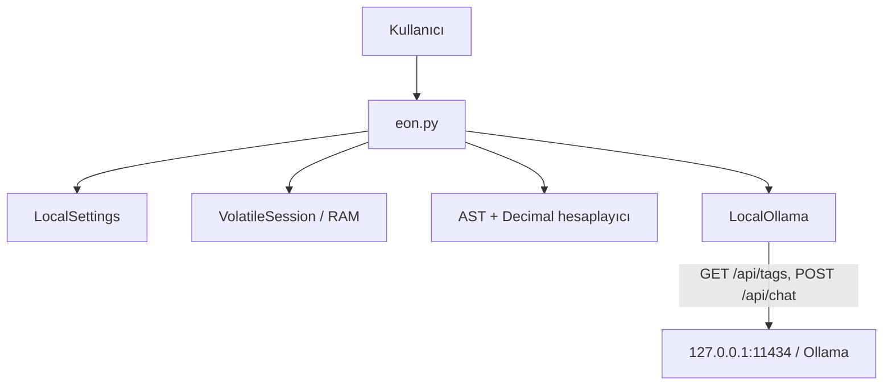
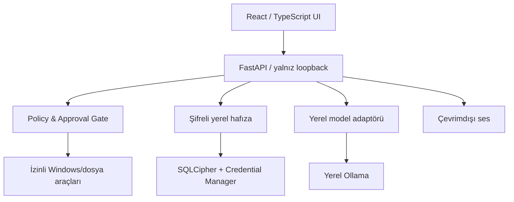

# EON mimarisi — mevcut ve hedef

## Mevcut v0.0.1

| Dosya | İşlev |
| --- | --- |
| `eon.py` | CLI, komutlar, sohbet döngüsü |
| `eon/config.py` | Yerel model listesi ve kişilik |
| `eon/provider.py` | Loopback HTTP istemcisi, istek sınırları |
| `eon/session.py` | RAM konuşma geçmişi |
| `eon/tools.py` | Sınırlı matematik |
| `tests/test_eon.py` | Birim ve negatif testler |

**Henüz yok:** FastAPI, React, SQLCipher, ses, dosya araçları, gerçek Windows kontrolü, onay durum makinesi.

## Hedef mimari — henüz uygulanmadı

**İzin modeli:** Her riskli araç isteği sunucu tarafında doğrulanmalı; PENDING → GRANTED → CONSUMED tek kullanımlık onay, süre aşımı ve kanonik argüman kontrolü yapılmalı. Modelin isteği izin yerine geçmez.

**Hafıza:** SQLCipher ve Windows Credential Manager hedef cihazda test edilmeden “şifreli hafıza hazır” denmez. Başarısızlıkta düz SQLite'a geçilmez.

**Ağ:** EON istemcisinin yerel Ollama HTTP API'si bulut API değildir. İlk indirme internet ister; Ollama/Windows'un başka ağ trafiği olmayacağı garanti edilmez. Harici model API'si, canlı web araştırması ve otomatik dış veri aktarımı tasarım dışıdır.

**Kabul kriteri:** Özellik için gerçek kod yolu, olumsuz senaryo testi, hedef cihaz doğrulaması ve açık kullanıcı izni gerekir.
